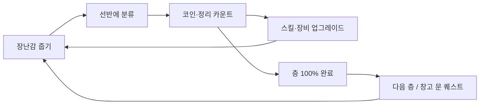

# 장난감 물류창고 정리 (가제) — 설계 문서 v0.1

- 장르: 인크리멘털(Incremental) / 정리 시뮬레이션
- 대상: 초·중학생
- 엔진: Godot 4.7 (GDScript)
- 최종 목표: 장난감 **10,000,000개** 정리
- 상태: 초안. `[가정]` 표시는 확인이 필요한 항목

## 1. 한 줄 콘셉트
어질러진 초대형 장난감 창고 4동을 한 층씩 정리한다. 줍고 → 분류하고 → 코인을 벌어 → 스킬과 장비를 올려 → 더 빨리 정리한다.

## 2. 핵심 루프

- 1회 행동(줍기→분류)은 2~5초. 숫자·효과음·팝업으로 즉시 보상
- 중반부터 로봇·컨베이어가 자동으로 정리, 플레이어는 업그레이드와 퀘스트에 집중

## 3. 월드 구조
| 구역 | 역할 |
|---|---|
| 창고 1~4 | 각 2층, 정리 선반은 10단 높이. 층마다 장난감 종류·물량 증가. 창고 1은 처음부터 열려 있음(튜토리얼 겸용) |
| 사무실(메뉴) | 업그레이드 상점, 퀘스트 게시판, 도감 |

### 창고 해금 (누적 정리 수 기준)
| 누적 정리 수 | 해금 |
|---|---|
| 0 (시작) | 창고 1 |
| 1,000 | 창고 2 개방 |
| 5,000 | 창고 3 개방 |
| 10,000 | 창고 4 개방 — **"와르르" 이벤트** |

**와르르 이벤트**: 1만 개 달성 시 창고 4의 문이 터지듯 열리며 장난감이 쏟아져 나온다. 화면 흔들림·대량 낙하 연출·전용 효과음. 장난감은 창고 밖(복도·마당)까지 넘쳐흘러 정리 구역이 확장된다. 초반 30분의 클라이맥스이자, 이후 본격적인 대량 정리(자동화 구간)의 시작점.

### 창고별 물량 — 합계 10,000,000
| 층 | 1층 | 2층 | 창고 합계 |
|---|---|---|---|
| 물량 | 1,250,000 | 1,250,000 | 2,500,000 |

### 정리 선반 (10단)
- 모든 선반은 10단 높이. 아래 단부터 채워지며, 단이 찰 때마다 연출과 보너스
- 단 높이별 자세: 1~3단 **웅크리고** 넣기 / 4~8단 **서서** 넣기 / 9~10단 **점프해서** 넣기
- 웅크리기·점프 없이 정리하게 되는 것이 스킬 성장의 보상 (5장 참고)
- 선반 수 `[가정]`: 층당 선반 10개 → 선반 1개 = 12.5만 개, 전체 80개
- 층 진행률 = 채워진 선반 단 수로 표시 (예: 층 물량의 10%마다 전체 선반 1단 완성)
- 선반 1개(10단)를 완성하면 스킬 1개 습득

- 층은 순서대로만 진행: 현재 층 100% → 다음 층 열림
- 전체 테마: **대형 물류센터**. 창고(동)별로 장난감 종류와 분위기 차별화 `[가정]`: 1 인형·봉제 / 2 블록·퍼즐 / 3 자동차·로봇 / 4 전 종류 뒤섞임(와르르)
- 물류센터 소품: 팔레트, 컨베이어, 박스 더미, 지게차(배경), 안전 표지, 형광등

## 4. 문 & 퀘스트 시스템
문 상태: `잠김 → 퀘스트 진행 → 열림 ⇄ 닫힘 → 완료 봉인`

| 상태 | 설명 |
|---|---|
| 잠김 | 누적 정리 수 미달. 문 앞에 필요 수량 표시 |
| 퀘스트 진행 | 해금 조건 달성 후 문 퀘스트 수행 (예: 열쇠 부품 3개 찾기, 특정 장난감 200개 분류) |
| 열림/닫힘 | 플레이어가 문을 직접 여닫음. 별도 규칙 없음(단순 출입) |
| 완료 봉인 | 2층까지 100% 정리 시 "정리 완료" 도장과 함께 봉인, 영구 보너스 지급 |

퀘스트 종류
- **문 퀘스트**: 창고·층 개방 조건 (메인 진행)
- **층 퀘스트**: 층 안의 소목표 (예: "빨간 블록 500개", "30초 안에 50개")
- **일일 퀘스트**: 접속 동기 (3개/일)
- **업적**: 누적 기록 (1만, 10만, 100만, 1,000만)

## 5. 성장(스킬·장비)
| 분류 | 항목 | 효과 |
|---|---|---|
| 손 스킬 | 들기 용량, 이동 속도, 줍기 범위(자석), 분류 속도 | 수동 효율 |
| 보너스 | 크리티컬 정리(×배수), 콤보(연속 분류), 코인 배율 | 도파민·수입 |
| 장비 | 카트 → 핸드 트럭 | 한 번에 들 수 있는 양 상승 `[가정]` |
| 자동화 | 정리 로봇, 컨베이어 벨트, 자동 분류기 | 초당 자동 정리 |
| 영구 | 창고 완료 봉인 보너스, 도감 수집 보너스 | 후반 가속 |

- 비용은 지수 증가(예: 기본가 × 1.15^레벨), 효과는 배수 누적
### 스킬 습득 규칙
- **선반 1개를 완성하면 스킬 1개를 배울 수 있다.** 배운 스킬은 코인으로 업그레이드할수록 정리가 편해진다
- 스킬 예시 `[가정]`:

| 스킬 | 효과 (업그레이드 시) |
|---|---|
| 긴 팔 | 웅크리기·점프 없이 모든 단에 넣기 가능. 레벨업 시 닿는 거리 증가 |
| 자동 정리 | 근처 장난감을 자동으로 선반에 넣음. 속도·범위 증가 |
| 빠른 손 | 줍기·넣기 동작 속도 증가 |
| 큰 손 | 한 번에 여러 개 집기 |
| 자석 | 줍기 범위 확대 |
| 크리티컬 정리 | 일정 확률로 ×배수 코인 |
| 콤보 | 연속 정리 시 코인 배율 증가 |
| 달리기 | 이동 속도 증가 |

- 플레이 감각: 초반은 웅크리고·점프하며 수동으로 → 중반 긴 팔로 편해짐 → 후반 자동 정리로 숫자가 폭발
- 환생(리셋)은 넣지 않고, 창고 완료 보너스로 대체 `[가정]`

## 6. 밸런스 목표
| 시점 | 목표 |
|---|---|
| 3~5분 | 1,000개 → 창고 2 개방 |
| 15분 | 5,000개 → 창고 3 개방, 첫 로봇 구매 |
| 30분 | 10,000개 → 창고 4 와르르 이벤트 |
| 3~5시간 | 100만 개 |
| 15~20시간 | 1,000만 개 엔딩 |

- 오프라인 보상: 자동화 수입의 일부를 최대 8시간까지 지급
- 미성년 대상: 확률형 과금 없음, 광고는 선택형 보상만

## 7. 화면 & 연출
- 시점: **3D 1인칭**, 화면에는 두 팔(손)만 보임. 줍기·분류 동작은 팔 애니메이션으로 표현
- 조작(PC, 가로 화면): `W A S D` 이동 / `Space` 점프 / `Shift` 웅크리기 / 마우스 시점 / 좌클릭으로 장난감 하나씩 줍고, 선반 앞에서 좌클릭으로 넣기
- 아트 스타일: **로우폴리 3D** (단순 형태, 플랫 컬러, 적은 텍스처)
- HUD: 누적 정리 수 / 1,000만 진행 바, 현재 층 %, 코인, 퀘스트 알림
- 타격감: 숫자 팝업, 정리될 때 "착" 소리, 콤보 카운터, 층 완료 시 전체 연출
- 정리 전후 대비: 층이 정리될수록 바닥이 드러나고 선반이 채워짐 (진행이 눈에 보임)

## 8. 기술 설계 (Godot 4.7)
| 항목 | 방식 |
|---|---|
| 대량 표현 | 실제 오브젝트는 화면에 수백~수천 개만. 나머지는 숫자로 관리하고 더미 높이·밀도로 표현 (3D `MultiMeshInstance3D`, 거리별 LOD, 화면 밖 컬링). 물리는 줍는 순간의 소수 오브젝트만 사용 |
| 데이터 | `Resource`(.tres): ToyData, UpgradeData, QuestData, FloorData — 밸런스 수정이 코드와 분리 |
| 전역 상태 | Autoload: `GameState`(수치), `SaveManager`, `EventBus`(시그널), `QuestManager` |
| 저장 | `user://save.json`, 자동 저장 30초 + 종료 시, 오프라인 시간 계산 |
| 수치 | 정리 수·코인은 int64로 충분 (1,000만 규모) |
| 플랫폼 | PC(Windows) 가로 화면, 키보드·마우스 |
| 플레이어 | `CharacterBody3D` 1인칭 컨트롤러 (이동·점프·웅크리기), 팔 모델은 별도 카메라 레이어 |

### 폴더 구조
```
project.godot
scenes/      main, warehouse, floor, door, player, robot, ui/
scripts/     autoload/, systems/, entities/, ui/
data/        toys/, upgrades/, quests/, floors/
assets/      sprites/, audio/, fonts/
```

## 9. 필요 사항
- 도구: Godot 4.7, Git, (Android 출시 시) Android SDK·키스토어
- 아트(로우폴리 3D): 장난감 모델 30~50종, 선반·팔레트·박스 등 물류센터 소품, 1인칭 팔 모델(리깅), UI 아이콘
- 사운드: 줍기·분류·콤보·구매·문 열림·층 완료, BGM 2~3곡
- 폰트: 한글 지원 무료 폰트

## 10. 개발 단계
| 단계 | 내용 | 완료 기준 |
|---|---|---|
| 0 | 프로젝트 세팅, Git, 폴더, Autoload 뼈대 | 빈 씬 실행 |
| 1 | 코어 루프: 이동·줍기·분류·카운트 (도형 그래픽) | 1,000개 정리가 재미있는지 검증 |
| 2 | 업그레이드 상점, 저장 | 성장 체감 |
| 3 | 창고·층·문·퀘스트 | 1만 개까지 플레이 가능 |
| 4 | 자동화(로봇·컨베이어), 오프라인 보상 | 100만 개 밸런스 |
| 5 | 연출·사운드·아트 교체 | 타격감 완성 |
| 6 | 1,000만 밸런싱, 업적·도감, 빌드 | 엔딩까지 플레이 |

## 11. 확인 필요
(확정: 와르르는 창고 밖으로 넘침 / 문은 단순 출입 / 3D 1인칭 두 팔 / WASD·Space·Shift / PC 가로 / 층별 물량 동일)

(추가 확정: 마우스 클릭 하나씩 / 선반 완성 시 스킬 습득·업그레이드 / 1~3단 웅크리기·4~8단 서서·9~10단 점프 / 긴 팔·자동 정리 스킬 / 로우폴리 / 대형 물류센터)

1. 층당 선반 수(10개 가정)와 스킬 총 개수·업그레이드 최대 레벨
2. 장난감 종류 수와 창고(동)별 분위기
3. 정리 전 장난감이 어디에 흩어져 있는가 (바닥 더미 / 박스 속 / 컨베이어 위)
